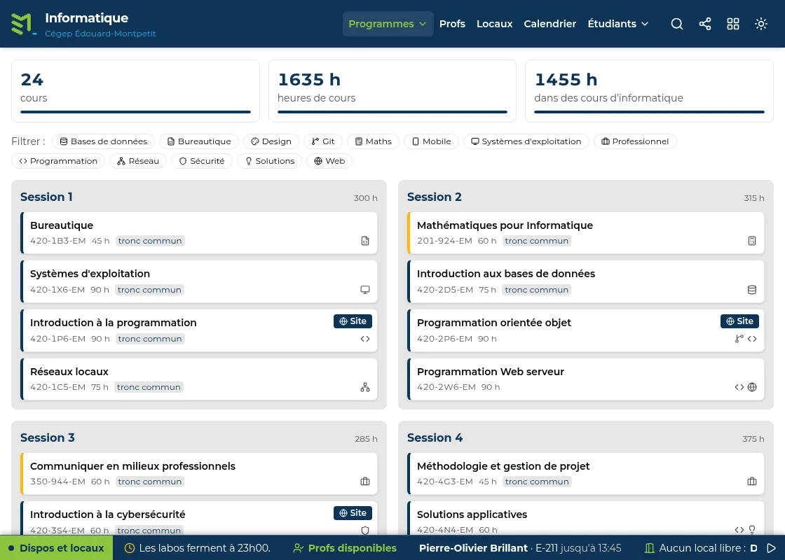
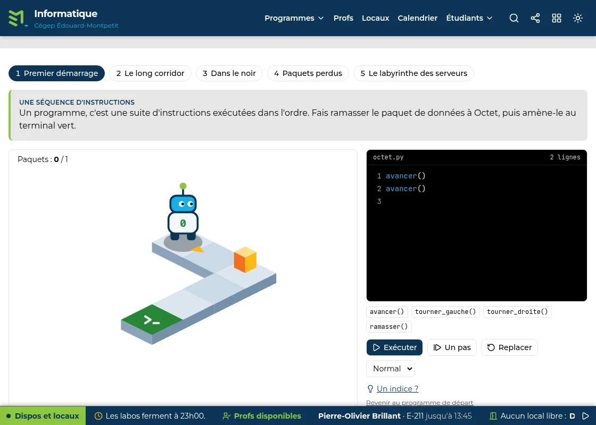
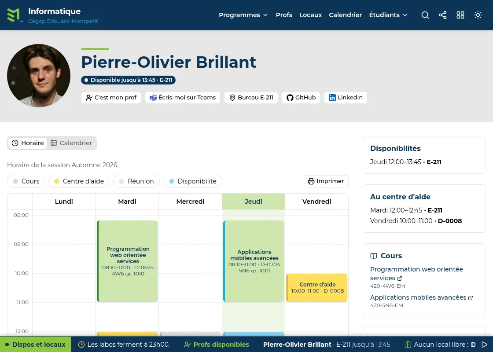
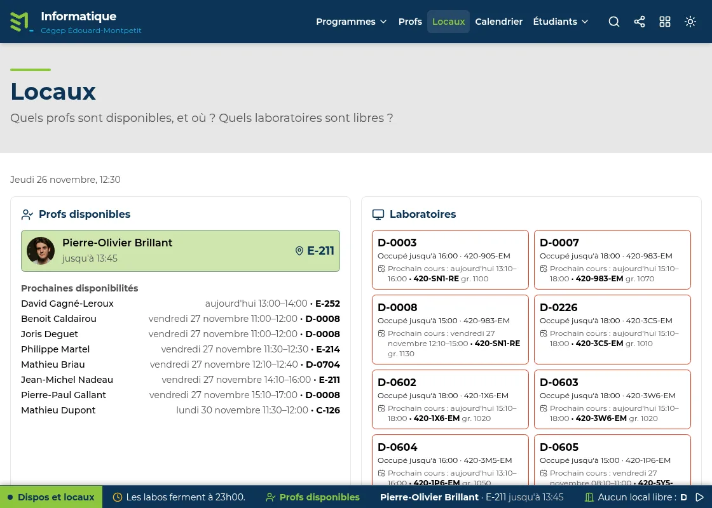
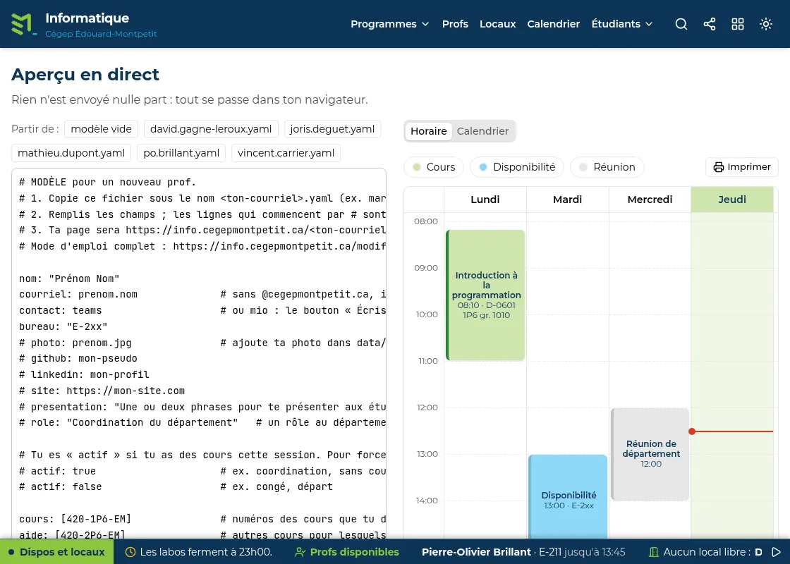
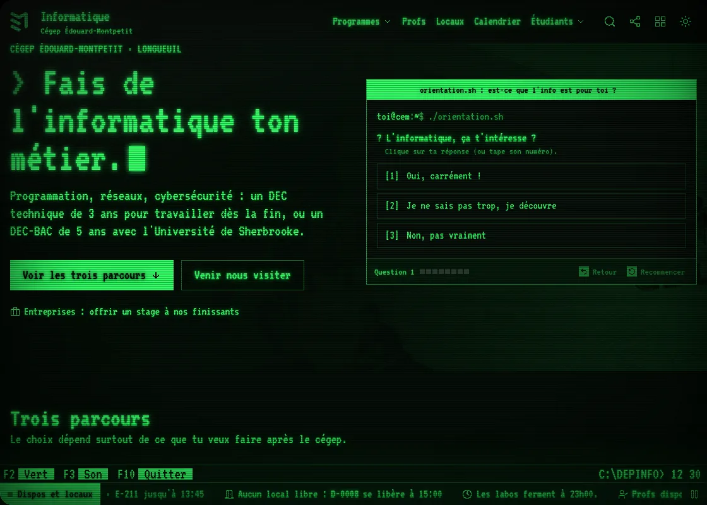
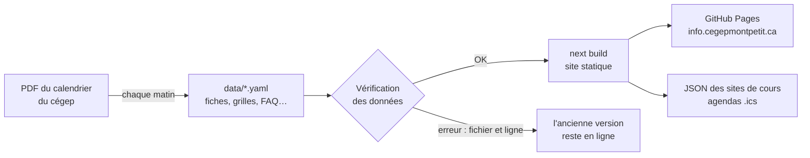

<div align="center">

<a href="https://info.cegepmontpetit.ca/"></a>

# Informatique · Cégep Édouard-Montpetit

**Le site du département d'informatique : programmes, profs, horaires, locaux et calendrier, toujours à jour.**

[](https://github.com/departement-info-cem/departement-info-cem.github.io/actions/workflows/deploy.yml)
[](https://info.cegepmontpetit.ca/)


[](LICENSE)

[**Visiter le site**](https://info.cegepmontpetit.ca/) · [Modifier ma page de prof](https://info.cegepmontpetit.ca/modifier-mon-profil) · [Signaler un problème](https://github.com/departement-info-cem/departement-info-cem.github.io/issues)

<br>

<a href="https://info.cegepmontpetit.ca/"></a>

</div>

## En bref

Un seul site pour tout le département :

- **les futurs étudiants et leurs parents** découvrent les trois parcours, les grilles de cours et testent leur logique avec des mini-jeux ;
- **les étudiants** trouvent leurs profs, leurs disponibilités, les laboratoires libres et le calendrier de la session ;
- **les profs** tiennent leur page à jour en modifiant un simple fichier texte, sans rien installer.

Tout le contenu vit dans des fichiers YAML lisibles ([`data/`](data/)), vérifiés à chaque modification, puis transformés en un site statique
publié sur GitHub Pages. Pas de serveur, pas de base de données, pas de mot de passe à gérer.

## Fonctionnalités

### 🎓 Choisir son programme

- **Trois parcours en un coup d'œil** : DEC Développement d'applications, DEC Administration d'infrastructure TI,
  DEC-BAC avec l'Université de Sherbrooke, et les AEC du soir.
- **Des grilles de cours interactives** : sessions, heures, filtres par techno (web, mobile, réseau, sécurité…),
  le site de chaque cours, et un comparateur de programmes.
- **Un bot d'orientation** qui a l'allure d'un terminal : « L'informatique, est-ce pour moi ? »
- **Deux mini-jeux** : programmer Octet, le robot, en Python, ou réparer une panne dans la salle réseau.
- Les prochaines portes ouvertes, Étudiant d'un jour et la demande d'admission, dès l'accueil.

<table>
  <tr>
    <td width="50%" align="center"><br><sub>Grille de cours, avec les filtres par techno</sub></td>
    <td width="50%" align="center"><br><sub>Octet, le robot : un premier programme en Python</sub></td>
  </tr>
</table>

### 📚 Suivre sa session

- **Une page par prof** : horaire de la semaine, disponibilités, heures au centre d'aide, bureau, et un bouton pour lui écrire (Teams ou MIO).
- **Locaux, en direct** : quels profs sont disponibles maintenant, et où ; quels laboratoires sont libres.
  Un bandeau au bas de chaque page le rappelle.
- **Mes cours** : on indique ses cours et son groupe, et le site met ses profs en premier, montre son horaire et son calendrier
  (examens, remises, cours annulés), et abonne l'agenda du téléphone à chaque cours, avec un rappel 15 minutes avant.
- **Le calendrier scolaire**, extrait automatiquement du PDF officiel du cégep et revérifié chaque matin.
- **Une recherche** (<kbd>Ctrl</kbd> + <kbd>K</kbd>) qui trouve un prof, un cours, un programme ou une réponse de la FAQ.
- Centre d'aide, FAQ, conseils aux nouveaux, logiciels gratuits, Git et commits, plagiat et IA.

<table>
  <tr>
    <td width="50%" align="center"><br><sub>La page d'un prof : son statut en direct et sa semaine</sub></td>
    <td width="50%" align="center"><br><sub>Locaux : les profs disponibles et les labos libres</sub></td>
  </tr>
</table>

### 🧑‍🏫 Pour les profs

- **Sa page dans un fichier texte** ([`data/profs/<courriel>.yaml`](data/profs/)), modifié directement sur GitHub et en ligne 2-3 minutes plus tard.
- **Un aperçu en direct** : on y colle sa fiche, les erreurs s'affichent avec le numéro de ligne, et on voit son horaire avant de publier.
- **Rien ne casse** : chaque modification est vérifiée ; en cas d'erreur, l'ancienne version reste en ligne et GitHub indique la ligne à corriger.
- **Des horaires préremplis** à chaque session, d'après l'horaire des laboratoires.
- **Des données pour les sites de cours** : un fichier JSON par cours (séances datées, horaires des groupes, agenda),
  pour ne plus recopier les dates d'une session à l'autre.
- Un outil pour **trouver un moment de rencontre** entre collègues.

<table>
  <tr>
    <td width="50%" align="center"><br><sub>Le guide en 5 étapes, sans rien installer</sub></td>
    <td width="50%" align="center"><br><sub>L'aperçu : la fiche à gauche, l'horaire à droite</sub></td>
  </tr>
</table>

### 📱 Partout

- **Pensé pour le téléphone**, et installable sur l'écran d'accueil comme une appli.
- **Un mode sombre**, automatique ou au choix.
- **Accessible** : menus utilisables au clavier, textes pour les lecteurs d'écran, animations coupées si le système le demande.
- Et pour les curieux, un easter egg : <kbd>↑</kbd> <kbd>↑</kbd> <kbd>↓</kbd> <kbd>↓</kbd> <kbd>←</kbd> <kbd>→</kbd> <kbd>←</kbd> <kbd>→</kbd> <kbd>B</kbd> <kbd>A</kbd>

<table>
  <tr>
    <td width="33%" align="center"><br><sub>Accueil</sub></td>
    <td width="33%" align="center"><br><sub>Page d'un prof, dispos d'abord</sub></td>
    <td width="33%" align="center"><br><sub>Locaux</sub></td>
  </tr>
</table>

<table>
  <tr>
    <td width="50%" align="center"><br><sub>Mode sombre</sub></td>
    <td width="50%" align="center"><br><sub>Le code Konami, pour les nostalgiques</sub></td>
  </tr>
</table>

## Sous le capot

| Rôle | Technologie |
| --- | --- |
| **Framework** | [Next.js 16](https://nextjs.org/) (App Router, export statique) et React 19 |
| **Langage** | TypeScript |
| **Interface** | Tailwind CSS 4, composants [shadcn/ui](https://ui.shadcn.com/) sur Base UI, icônes Lucide |
| **Données** | YAML dans [`data/`](data/), validé par [Zod](https://zod.dev/) |
| **Qualité** | Tests Vitest, ESLint, vérification des données et des types à chaque pull request |
| **Hébergement** | GitHub Pages, déployé par GitHub Actions |



Le site est reconstruit à chaque push sur `main`, et chaque matin de semaine pour reprendre le calendrier du cégep s'il a changé.

### Structure du dépôt

```text
.
├── data/              Le contenu du site, en YAML
│   ├── profs/         une fiche par prof : <courriel>.yaml
│   ├── programmes/    les grilles de cours (DEC, DEC-BAC, AEC)
│   ├── photos/        les photos des profs
│   └── *.yaml         cours, laboratoires, calendrier scolaire, FAQ, bot, logiciels
├── web/               Le site Next.js
│   ├── app/           les pages (un dossier par adresse)
│   ├── components/    les composants React
│   ├── lib/           la logique : horaires, disponibilités, agendas, calendrier
│   ├── scripts/       vérification des données, calendrier scolaire, photos
│   └── tests/         les tests Vitest
└── angular/           l'ancien site, plus déployé (il sera supprimé)
```

## Contribuer

Les contributions sont les bienvenues, que tu sois prof, étudiant ou diplômé.

### Tu es prof : modifier ta page

Rien à installer : suis le guide [Profs : modifier ma page](https://info.cegepmontpetit.ca/modifier-mon-profil).
Il ouvre ta fiche dans l'éditeur de GitHub et explique chaque champ. Il faut un compte GitHub membre de
l'organisation `departement-info-cem` : demande-le à la coordination.

### Signaler un problème ou proposer une idée

Une information erronée, un bug, une page qui manque ? [Ouvre une issue](https://github.com/departement-info-cem/departement-info-cem.github.io/issues).

### Développer

Prérequis : [Node.js 22](https://nodejs.org/) et npm.

```bash
git clone https://github.com/departement-info-cem/departement-info-cem.github.io.git
cd departement-info-cem.github.io/web
npm ci
npm run dev    # http://localhost:3000
```

Avant d'ouvrir une pull request :

| Commande | Ce qu'elle vérifie |
| --- | --- |
| `npm run valider` | les fichiers de `data/` (erreurs avec le fichier et la ligne) |
| `npm run lint` | ESLint |
| `npm test` | les tests Vitest |
| `npm run build` | le build complet, avec la vérification des types |

1. Crée une branche à partir de `main`.
2. Ouvre une pull request : GitHub Actions refait la vérification des données, le build, le lint et les tests.
3. Si ta PR change l'apparence du site, montre l'avant et l'après côte à côte
   (voir [Captures avant / après](CLAUDE.md#captures-avant--après-dans-les-pr)).
4. Une fois la PR fusionnée dans `main`, le site est en ligne en quelques minutes.

Pour aller plus loin :

- [Documentation technique](web/README.md) : les données, le calcul des profs actifs, le calendrier scolaire,
  le JSON des sites de cours et les anciennes adresses.
- [Changement de session](data/changement-de-session.md) : mettre à jour les horaires des profs et des laboratoires.

## Licence

[MIT](LICENSE) © Département d'informatique, Cégep Édouard-Montpetit

<div align="center">
<br>
<sub>Fait à Longueuil, au département d'informatique du <a href="https://www.cegepmontpetit.ca/">Cégep Édouard-Montpetit</a>.</sub>
</div>
